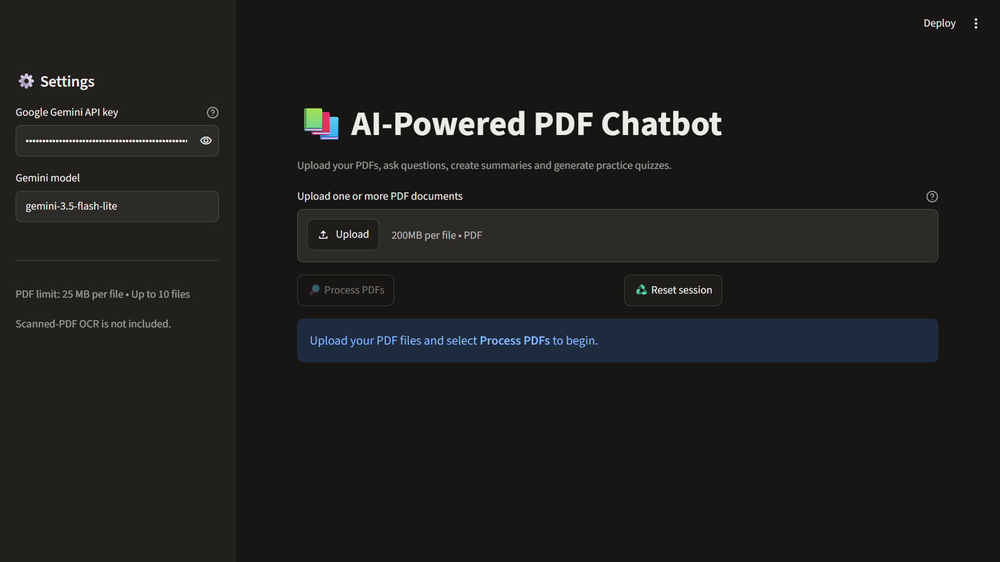
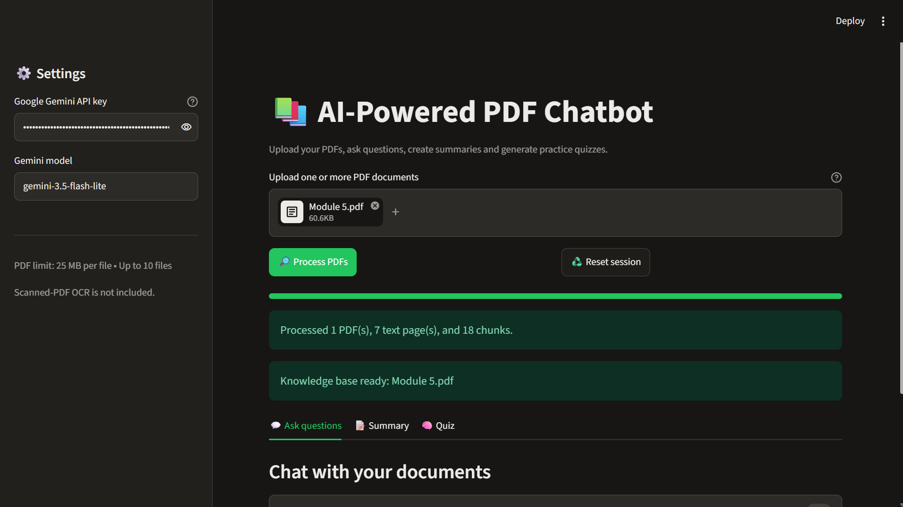
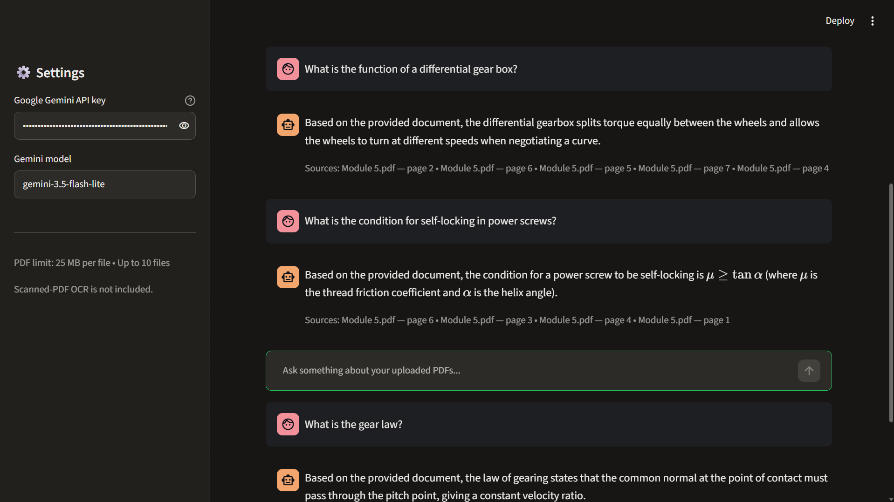
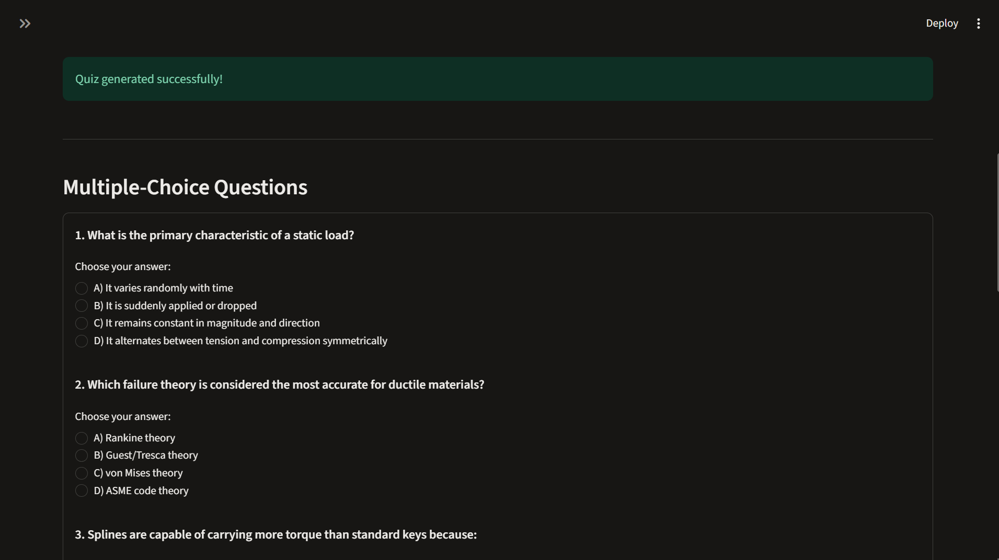
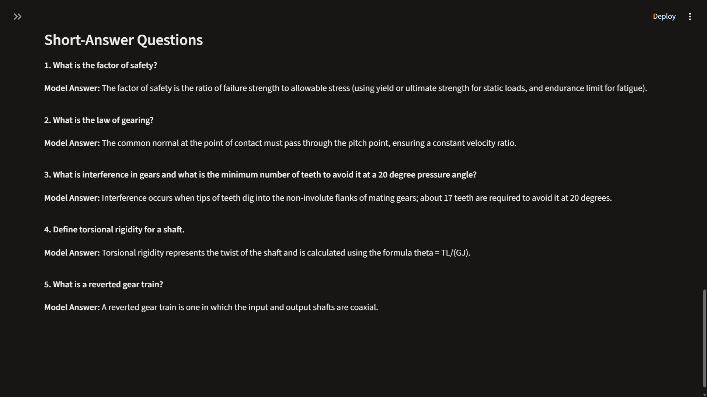

# AI PDF Analyzer

An individual Generative AI project that uses **Retrieval-Augmented Generation (RAG)** to interact with uploaded PDF documents. The application allows users to ask questions, generate concise document summaries, and create quizzes based on the uploaded content.

## Features

- Upload up to 10 text-based PDF documents (25 MB each).
- Extract text page by page using PyPDF.
- Split extracted text into overlapping chunks while retaining source and page metadata.
- Generate sentence embeddings using Sentence Transformers.
- Store and retrieve document vectors using FAISS.
- Answer questions using Google Gemini and relevant retrieved PDF context.
- Display source document names and page numbers.
- Generate concise, topic-wise document summaries.
- Generate multiple-choice and short-answer quizzes.
- Evaluate quiz responses and provide explanations or model answers.
- Reset the current application session.

## Application Screenshots

### Home Screen


### PDF Processing


### Question Answering


### Document Summary


### Multiple-Choice Quiz


### Short-Answer Quiz


## Technology Stack

| Technology | Purpose |
|---|---|
| Python | Core programming language |
| Streamlit | Application interface |
| Google Gemini API | AI-powered response generation |
| LangChain | Document processing and RAG components |
| Sentence Transformers | Text embedding generation |
| FAISS | Vector storage and similarity search |
| PyPDF | PDF text extraction |

## Requirements

- Windows 10/11, macOS or Linux
- Python 3.11 or newer
- Internet connection for Gemini API access and initial embedding-model download
- Google Gemini API key

## Installation

### 1. Clone the repository

```bash
git clone https://github.com/sleuth-in-the-system/AI-PDF-Analyzer.git
cd AI-PDF-Analyzer
```

### 2. Create a virtual environment

**Windows (PowerShell):**

```powershell
python -m venv .venv
.\.venv\Scripts\Activate.ps1
```

**macOS / Linux:**

```bash
python3 -m venv .venv
source .venv/bin/activate
```

### 3. Install dependencies

```bash
python -m pip install --upgrade pip
pip install -r requirements.txt
```

## API Configuration

The application requires a Google Gemini API key.

Obtain an API key through [Google AI Studio](https://aistudio.google.com/).

Use the application's supported Streamlit secrets configuration.


## Running the Application

After installing dependencies and configuring the API key, launch the application:

```bash
streamlit run app.py
```

Streamlit will provide a local URL, usually:

```text
http://localhost:8501
```

Open the URL in your browser to access AI PDF Analyzer.

## Project Structure

```text
AI-PDF-Analyzer/
│
├── app/
│   ├── __init__.py
│   ├── core.py
│   └── services.py
│
├── screenshots/
│   ├── HomeScreen.png
│   ├── pdfProcessed.png
│   ├── Chat.png
│   ├── Summary.png
│   ├── mcqQuiz.png
│   └── saqQuiz.png
│
├── .streamlit/
│   └── config.toml
│
├── app.py
├── requirements.txt
├── .env.example
├── .gitignore
└── README.md
```

## How It Works

The application follows a Retrieval-Augmented Generation (RAG) workflow:

1. **PDF Upload:** Users upload one or more PDF documents.
2. **Text Extraction:** PyPDF extracts text from individual pages.
3. **Text Chunking:** LangChain's recursive text splitter divides the extracted text into overlapping chunks.
4. **Embedding Generation:** Sentence Transformers converts the chunks into dense vector representations.
5. **Vector Storage:** FAISS stores the embeddings and enables similarity-based retrieval.
6. **Question Retrieval:** The user's question is embedded and used to retrieve relevant document chunks.
7. **Response Generation:** Retrieved context and the user's question are passed to Google Gemini with grounding instructions.
8. **Answer Presentation:** The application displays the generated response along with relevant source document and page information.

The same processed document content is also used to support summarization and quiz generation.

## Limitations

- OCR support for scanned or image-only PDFs is not included.
- Text extraction quality depends on the structure and quality of the source PDF.
- Google Gemini requires an internet connection and an available API quota.
- AI-generated answers, summaries and quizzes may contain inaccuracies and should be verified against the original document.
- The application maintains document vectors and chat context within the Streamlit session rather than providing permanent user accounts or persistent document storage.

## Security and Responsible Usage

- Keep `.env` files and Streamlit secrets out of version control.
- Never upload API keys, credentials or private documents to GitHub.
- Only upload documents you have permission to process.
- Review Google's API data-use terms before processing sensitive information.

## Author

Prerana Banerjee